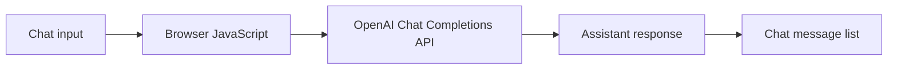

# Personal Chatbot — Browser UI Prototype

 

A minimal static chat interface wired to the OpenAI Chat Completions API using the gpt-4o-mini model. The repository contains a single HTML page, CSS styling, and a small JavaScript request handler.

## Why it matters

This project is an early exploration of a conversational UI and an API-backed assistant. It provides a simple starter interface for interacting with language models.

## Project flow

## Current implementation status

> **Implementation notes:** `index.html` references `script.js`, while the tracked script file is currently `script.js.js`. In addition, the API key constant in that file is empty by default.

## Security warning

Do **not** put a real OpenAI API key in browser client-side JavaScript in production. Anyone who loads the page can inspect the key. For a production deployment, send chat requests through a server-side proxy or backend endpoint that reads the API key from environment variables and never exposes it to client browsers.

## Repository files

| File | Purpose |
|---|---|
| `index.html` | Chat page layout, container, and input elements |
| `styles.css` | Chat layout, bubble styling, and dark theme variables |
| `script.js.js` | Browser-side request and message-handling logic |

## Run locally

Open `index.html` in a modern browser to inspect the layout. For functional messaging, align the script filename reference and configure an API endpoint.

No automated test suite or external benchmark is currently included in this repository.

[Browse the source](https://github.com/MokuLakshithReddy/My-Personal-ChatBot)
