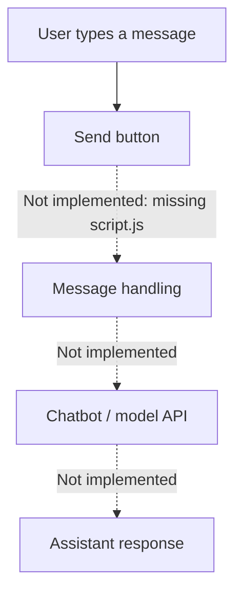

# My Personal Chatbot — Basic Web UI Scaffold

A minimal HTML/CSS chat interface with a welcome message, message area, text input, and Send button.

## Current state

<badge></badge>

The repository currently contains:
- `index.html` — the chat layout and a script reference to `script.js`.
- `styles.css` — basic chat window and message styling.

**Known blocker:** `script.js` is referenced by the HTML but is not present in the current repository snapshot. The earlier README also refers to `Script.js.js`, which is not present either. As a result, message submission and chatbot responses are not implemented in this checkout.

## Intended interaction

## Run the current UI

Open `index.html` in a modern browser. The static layout and CSS should render, but the chat Send action will not work until the missing JavaScript handler is added.

## What is needed to complete it

1. Add `script.js` and implement message rendering, input validation, and error states.
2. Decide which model/provider API should power responses.
3. Keep API credentials on a server or secure backend; never expose a private API key in browser JavaScript.
4. Add a safe configuration example, setup instructions, and tests.
5. Add screenshots or a short recording after the complete interaction works.

No AI model integration, functional chatbot test, or benchmark is currently present in this repository.

[Browse the source](https://github.com/MokuLakshithReddy/My-Personal-ChatBot)
